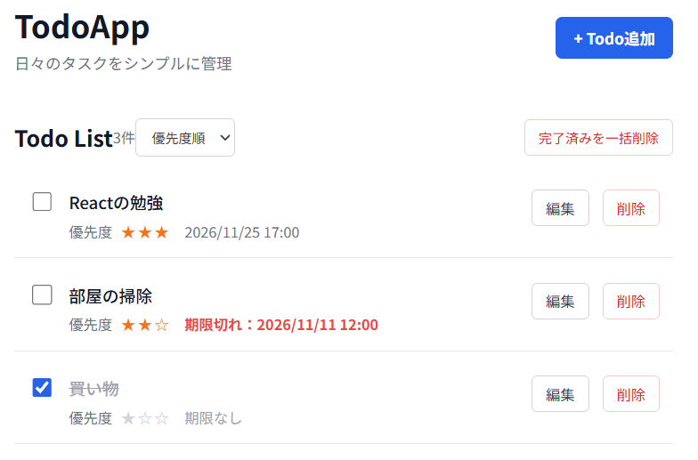
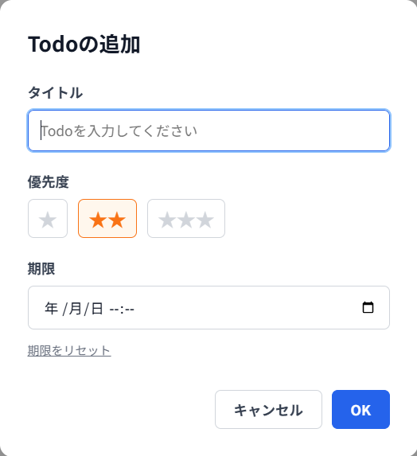
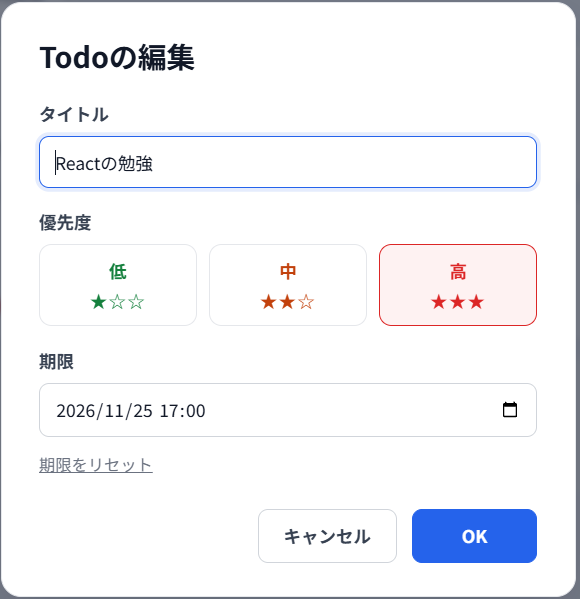
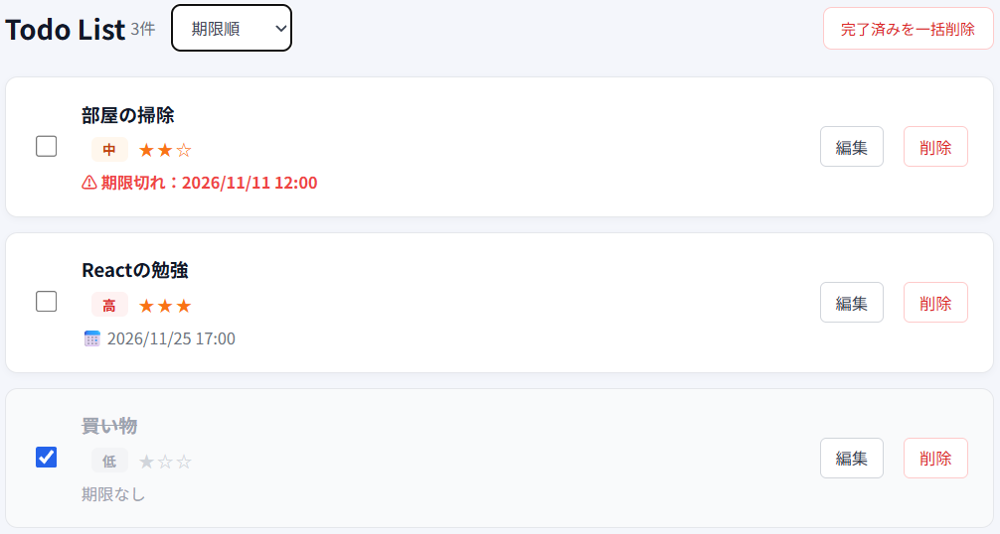
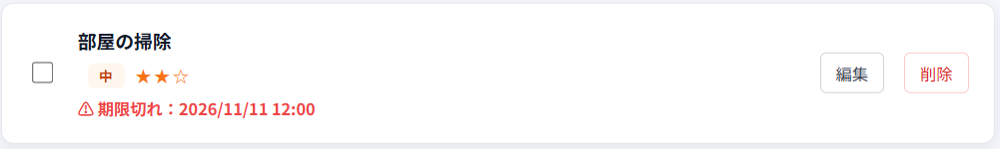

# TodoApp

**公開URL：** https://kkotaro0840.github.io/todo-app/

## 1. アプリの概要

TodoAppは、日々のタスクを簡単に管理するためのWebアプリケーションです。

Todoの追加や編集、削除に加え、優先度や期限を設定することで、タスクの重要性や取り組む順番を整理できます。

シンプルで見やすいデザインを目指し、日常的に使いやすいTodoアプリを制作しました。

## 2. 主な機能

- **Todoの追加・編集・削除**：タスクの登録や内容の変更、不要になったタスクの削除ができます。
- **優先度の設定**：各Todoに3段階の優先度を設定できます。
- **期限の設定**：タスクごとに期限を設定できます。期限を設定しないことも可能です。
- **並べ替え**：優先度順または期限順にTodoを並べ替えられます。
- **完了状態の管理**：チェックボックスでTodoの完了・未完了を切り替えられます。
- **完了済みTodoの一括削除**：完了したTodoをまとめて削除できます。
- **期限切れの表示**：未完了のまま期限を過ぎたTodoは、通常とは異なる表示になります。
- **データの保存**：ブラウザのlocalStorageを利用し、ページを再読み込みしてもTodoの情報を保持します。

## 3. 工夫した点・特徴

Todoの優先度と期限を設定できるようにすることで、単にタスクを記録するだけでなく、取り組む順番を整理できるようにしました。

また、期限を過ぎた未完了のTodoを通常のTodoと区別して表示することで、対応が必要なタスクを見つけやすくしています。

データの保存にはlocalStorageを使用し、ブラウザを再読み込みしても登録したTodoが消えないようにしました。

## 4. 開発で苦労した点

<!-- 実際に苦労したことや、解決するために工夫したことを記入 -->

## 5. 使用技術

- React
- TypeScript
- Vite
- HTML
- CSS
- localStorage
- Git / GitHub
- GitHub Pages

## 6. スクリーンショット

<!-- screenshotsフォルダを作成し、実際の画像を5枚以上配置する -->

### Todo一覧画面

### Todo追加画面

### Todo編集画面

### 並べ替え画面

### 期限切れTodoの表示

## 7. 開発期間・開発時間

開発期間：未記入 ～ 未記入（約未記入時間）
